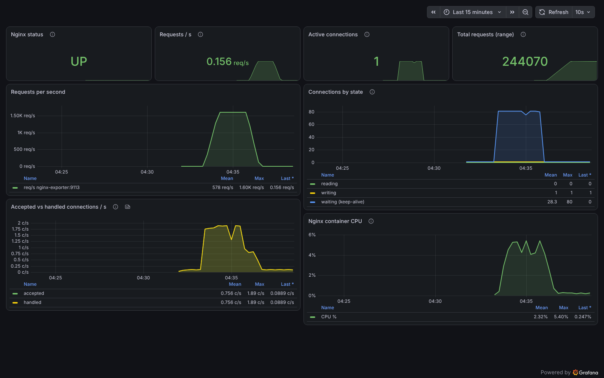
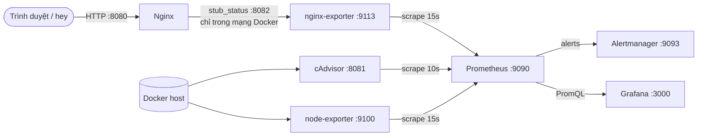
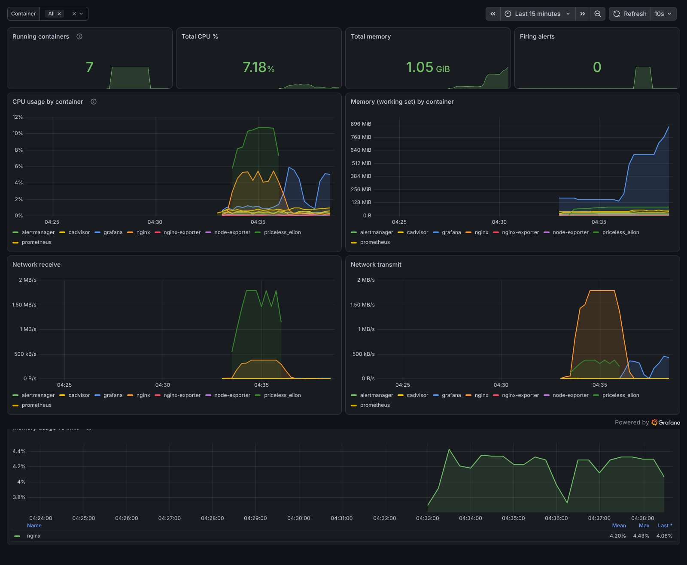

# 📊 Nginx & Docker Monitoring với Prometheus + Grafana

[](https://github.com/t1kay/nginx-docker-monitoring/actions/workflows/ci.yml)

Dự án lab giám sát **Nginx** và **các container Docker** bằng Prometheus, Grafana và Alertmanager.
Chỉ cần một lệnh `docker compose up`, bạn có ngay: thu thập metric, 2 dashboard dựng sẵn, recording rules,
alert rules có unit test và một script tạo tải để thấy biểu đồ và cảnh báo thay đổi.



---

## Kiến trúc



| Thành phần | Vai trò | Metric chính |
|---|---|---|
| **nginx-exporter** | Đọc trang `stub_status` của Nginx, đổi sang định dạng Prometheus | `nginx_up`, `nginx_http_requests_total`, `nginx_connections_*` |
| **cAdvisor** | Đo tài nguyên từng container | `container_cpu_usage_seconds_total`, `container_memory_working_set_bytes`, `container_network_*` |
| **node-exporter** | Đo tài nguyên máy host | `node_cpu_seconds_total`, `node_memory_*` |
| **Prometheus** | Kéo (scrape) metric định kỳ, lưu time series, tính rules | |
| **Alertmanager** | Gom nhóm, chặn trùng và gửi cảnh báo | |
| **Grafana** | Vẽ dashboard từ PromQL | |

---

## Chạy nhanh

Yêu cầu: **Docker** + **Docker Compose v2**.

```bash
git clone https://github.com/t1kay/nginx-docker-monitoring.git
```

```bash
cd nginx-docker-monitoring
```

```bash
docker compose up -d --wait
```

| Dịch vụ | URL | Ghi chú |
|---|---|---|
| Trang web Nginx | http://localhost:8080 | |
| Grafana | http://localhost:3000 | `admin` / `admin` (đổi trong `.env`) |
| Prometheus | http://localhost:9090 | xem **Status → Targets**, **Alerts** |
| Alertmanager | http://localhost:9093 | |
| cAdvisor | http://localhost:8081 | |

Trong Grafana mở thư mục **Monitoring Lab** → dashboard **Nginx Overview** và **Docker Containers**.

Dừng lab:

```bash
docker compose down
```

Xoá luôn dữ liệu đã lưu:

```bash
docker compose down -v
```

---

## Tạo tải và xem cảnh báo bật

```bash
./scripts/load-test.sh
```

Script giữ 80 kết nối tới Nginx trong 3 phút (dùng [`hey`](https://github.com/rakyll/hey) chạy trong Docker).
Sau khoảng 1 phút:

1. Dashboard **Nginx Overview**: `Requests / s` và `Active connections` tăng vọt.
2. Prometheus → **Alerts**: `NginxHighConnections` chuyển `Inactive → Pending → Firing`
   (vì rule có `for: 1m`, phải vượt ngưỡng liên tục 1 phút mới bắn).
3. Alertmanager (http://localhost:9093) hiện cảnh báo vừa nhận.

Tuỳ chỉnh: `DURATION=5m CONCURRENCY=150 ./scripts/load-test.sh`.
Thử `ERRORS=1 ./scripts/load-test.sh` để gọi `/error` (HTTP 500) và tự nhận ra giới hạn của `stub_status`
(gợi ý: xem [cheatsheet](docs/promql-cheatsheet.md#giới-hạn-của-stub_status)).



---

## Rules

**Recording rules** ([`prometheus/rules/recording.rules.yml`](prometheus/rules/recording.rules.yml)) tính trước các câu PromQL hay dùng,
đặt tên theo quy ước `level:metric:operation`:

| Rule | Ý nghĩa |
|---|---|
| `job:nginx_http_requests:rate1m` | Số request/giây của Nginx |
| `name:container_cpu_usage:percent` | % CPU mỗi container (100% = 1 core) |
| `name:container_memory_working_set:bytes` | RAM đang dùng mỗi container |
| `name:container_memory_usage:ratio` | RAM dùng / giới hạn (chỉ container có đặt limit) |
| `instance:node_cpu_utilisation:percent` | % CPU của máy host |

**Alert rules** ([`prometheus/rules/alerts.rules.yml`](prometheus/rules/alerts.rules.yml)):

| Alert | Điều kiện | Mức |
|---|---|---|
| `TargetDown` | `up == 0` trong 2 phút | warning |
| `NginxDown` | `nginx_up == 0` trong 1 phút | critical |
| `NginxHighConnections` | hơn 50 kết nối đang mở trong 1 phút | warning |
| `ContainerHighCPU` | container dùng hơn 80% CPU trong 5 phút | warning |
| `ContainerHighMemory` | container dùng hơn 90% memory limit trong 2 phút | warning |

Mọi alert đều có **unit test** trong [`prometheus/tests/alerts.test.yml`](prometheus/tests/alerts.test.yml), chạy bằng `promtool test rules`.

Sau khi sửa rule, nạp lại Prometheus mà không cần khởi động lại:

```bash
curl -X POST http://localhost:9090/-/reload
```

---

## Kiểm tra cấu hình

```bash
./scripts/check.sh
```

Chạy lần lượt: `docker compose config`, `promtool check config`, `promtool check rules`, `promtool test rules`,
`amtool check-config`, kiểm tra JSON dashboard và `yamllint`. CI trên GitHub Actions chạy script này,
sau đó dựng cả stack để chắc chắn mọi target đều `up` và Grafana đã nạp dashboard.

---

## Gửi cảnh báo về Telegram (tuỳ chọn)

1. Tạo bot với [@BotFather](https://t.me/BotFather), lấy token, lấy `chat_id` của bạn.
2. Lưu token vào file `alertmanager/telegram_token` (file này đã nằm trong `.gitignore`).
3. Trong [`alertmanager/alertmanager.yml`](alertmanager/alertmanager.yml) bỏ comment receiver `telegram`,
   điền `chat_id` và đổi `receiver: default` thành `receiver: telegram`.
4. `docker compose restart alertmanager`.

---

## Cấu trúc thư mục

```
.
├── docker-compose.yml
├── nginx/                       # nginx.conf (bật stub_status ở cổng nội bộ 8082) + trang mẫu
├── prometheus/
│   ├── prometheus.yml           # scrape_configs cho 5 job
│   ├── rules/                   # recording + alert rules
│   └── tests/                   # unit test cho rules (promtool)
├── alertmanager/alertmanager.yml
├── grafana/
│   ├── provisioning/            # tự tạo datasource + nạp dashboard khi khởi động
│   └── dashboards/              # dashboard dạng JSON
├── scripts/                     # check.sh, load-test.sh
├── docs/                        # PromQL cheatsheet, ảnh chụp
└── .claude/                     # rules + skills cho Claude Code
```

---

## Xử lý sự cố

**Dashboard Docker Containers trống, `container_*` không có label `name`.**
cAdvisor không kết nối được Docker/containerd. Xem log:

```bash
docker logs cadvisor 2>&1 | grep "container factory"
```

Nếu thấy `Registration of the docker container factory failed ... containerd.sock`, tìm socket containerd thật của máy
(ví dụ `/var/run/docker/containerd/containerd.sock`) và thêm vào `command` của cAdvisor:
`--containerd=/đường/dẫn/containerd.sock`.

**Target `down` trong Prometheus.** Mở http://localhost:9090/targets xem cột *Error*, rồi `docker compose logs <service>`.

---

## Học thêm

- [docs/promql-cheatsheet.md](docs/promql-cheatsheet.md): counter và gauge, `rate()`, `sum by`, `histogram`, kèm toàn bộ câu PromQL dùng trong dashboard.
- [Prometheus docs](https://prometheus.io/docs/), [Grafana docs](https://grafana.com/docs/grafana/latest/).

## License

MIT
